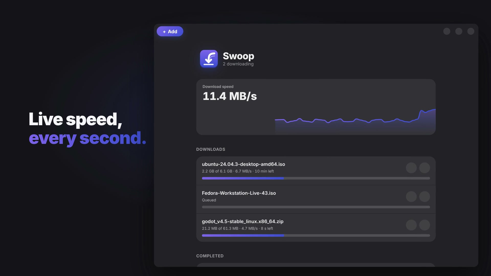
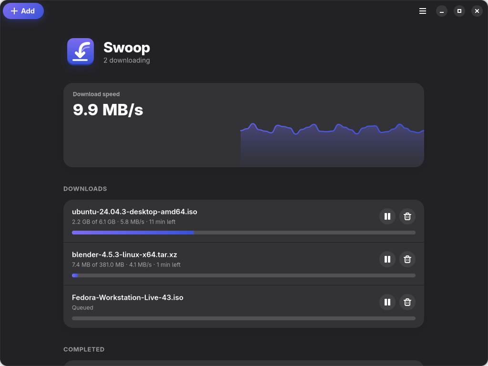

<p align="center">
  
</p>

<h1 align="center">Swoop</h1>

<p align="center">
  <strong>A fast, good-looking download manager for Linux, powered by aria2.</strong><br>
  Sixteen connections per file, downloads handed over from your browser, torrents and magnet links,
  and a queue that survives restarts.
</p>

<p align="center">
  <a href="LICENSE"></a>
  
  
  
  
  
  
</p>

<p align="center">
  <a href="docs/media/swoop-launch.mp4">
    
  </a>
  <br>
  <sub>▶ <a href="docs/media/swoop-launch.mp4">Watch the 20-second launch video</a></sub>
</p>

## Features

- **Segmented downloads.** aria2 splits every file over up to 16 connections and resumes partial
  files; large downloads start immediately.
- **Live progress.** Speed counter and an animated one-minute speed graph, per-download
  sparklines, progress, ETA, pause, resume and remove.
- **Browser integration.** An extension for Firefox, Zen, LibreWolf, Chromium and Google Chrome hands
  downloads over to Swoop, with cookies on Firefox so downloads behind a login work. If Swoop is not
  running, the browser keeps the download.
- **Torrents and magnet links.** Open `.torrent` files (Ctrl+O) or paste magnet links; Swoop also
  registers itself for `magnet:` links on the desktop.
- **Queue that survives restarts.** Unfinished downloads live in aria2's session file; completed
  ones go to a local history.
- **Limits.** Number of simultaneous downloads and a global speed limit, applied live.
- **One-click setup.** On first launch a guide sets the download folder, limits, browser
  integration and the launcher entry, then helps install the browser extension.
- **Keyboard and CLI.** `swoop add <url>` from any terminal reaches the running app over D-Bus;
  without a display Swoop runs headless.

<p align="center">
  
</p>

## Install

Swoop needs Python 3.11+, GTK 4, libadwaita, PyGObject and aria2 from your distribution:

```sh
sudo pacman -S aria2 gtk4 libadwaita python-gobject                    # Arch
sudo apt install aria2 gir1.2-gtk-4.0 gir1.2-adw-1 python3-gi          # Debian / Ubuntu
sudo dnf install aria2 gtk4 libadwaita python3-gobject                 # Fedora
```

Then install Swoop from source with [uv](https://docs.astral.sh/uv/):

```sh
git clone https://github.com/Helixo22/swoop && cd swoop
uv venv --system-site-packages   # reuse the system PyGObject
uv sync
uv run swoop                     # the setup guide opens on first launch
```

The setup guide adds Swoop to your app launcher; `swoop install-desktop` does the same by hand.

### Flatpak

```sh
flatpak-builder --user --install --force-clean build-dir packaging/flatpak/io.github.swoop.Swoop.yml
flatpak run io.github.swoop.Swoop
```

The Flatpak bundles aria2 and installs its own launcher entry and icons. Browser integration
needs the native host on the host system, so for now it works with the uv/pip installation.

## Usage

```sh
swoop                         # open the window (aria2 runs in the background)
swoop add <url|magnet> [--dir DIR] [--out NAME]
swoop add-torrent <file.torrent> [--dir DIR]
swoop open <url|magnet|file>  # what the desktop calls for magnet links and .torrent files
swoop list                    # unfinished downloads
swoop quit                    # stop Swoop and aria2
swoop setup-browsers          # register the browser host and export the extension
swoop install-desktop         # add Swoop and its icon to the app launcher
```

- Commands sent while Swoop is running are forwarded to the running instance over D-Bus;
  otherwise the command starts Swoop in the background first (`setup-browsers` and
  `install-desktop` always run on their own).
- `--dir` paths must stay inside your home directory; relative ones start there.
- Closing the window keeps downloads going; choose Quit (Ctrl+Q) to stop them.
- Preferences (Ctrl+,) set the download folder, the number of simultaneous downloads and the speed
  limit, saved in `~/.config/swoop/config.toml`. The setup guide can be reopened from the menu.
- Torrents seed until a share ratio of 1.0, aria2's default.

| Shortcut | Action |
| --- | --- |
| Ctrl+N | Add a download (a link in the clipboard is filled in) |
| Ctrl+O | Open a .torrent file |
| Ctrl+, | Preferences |
| Ctrl+Q | Quit Swoop and stop aria2 |

## Browser extension

The setup guide installs it in every detected browser:

- **Firefox, Zen, LibreWolf.** Firefox-based browsers permanently install only add-ons signed by
  Mozilla. Until a signed package ships (put it at `src/swoop/data/swoop-firefox-signed.xpi` and
  the Install button uses it), Swoop opens `about:debugging`: choose "Load Temporary Add-on" and
  pick `manifest.json` in the folder Swoop shows; the add-on stays until the browser restarts. To
  sign it with your own addons.mozilla.org account: `npx web-ext sign --channel=unlisted
  --source-dir ~/.local/share/swoop/browser-extension/firefox --api-key=… --api-secret=…`.
- **Chromium, Google Chrome.** The browser opens its extensions page together with the folder to
  pick with "Load unpacked" (Developer mode); this install is permanent.
- **Flatpak browsers** are listed but cannot be connected: their sandbox does not let an
  extension start programs outside it.

`swoop setup-browsers` exports the same builds to `~/.local/share/swoop/browser-extension`.
Private-window downloads are never intercepted. If a hand-off fails, the reason (never cookies
or other header values) is logged to `~/.local/state/swoop/native-host.log`.

The Firefox build also forwards the site's cookies for intercepted downloads. aria2 cannot scope a
header to one host: if the server redirects the download to another site, the cookies are sent
there too. Links sent with "Download with Swoop" never carry cookies, since they are often
redirectors.

## How it works

Swoop never downloads anything itself. It starts `aria2c` with RPC bound to localhost and a
random secret passed through a memfd (never on the command line), restarts it if it crashes, and
drives it over JSON-RPC with a thin httpx client. The GTK4/libadwaita window, the CLI and the
browser's native messaging host all talk to one primary instance over D-Bus, so the RPC secret
never leaves that process. Queue limits and the download folder are aria2 global options; the
queue itself is aria2's session file.

```
browser extension ──native messaging──▶ swoop-native-host ─┐
swoop add / list / quit (CLI) ─────────────────────────────┼─D-Bus─▶ Swoop ──JSON-RPC──▶ aria2c
desktop (magnet links, .torrent files) ────────────────────┘           (GTK4 + libadwaita)
```

## Development

```sh
uv venv --system-site-packages
uv sync
uv run ruff check . && uv run ruff format --check . && uv run mypy   # mypy runs in strict mode
```

## Credits

- Downloads by [aria2](https://aria2.github.io/); interface built with GTK 4 and libadwaita.
- Inspired by Free Download Manager.
- Launch video made with [HyperFrames](https://hyperframes.heygen.com/). Music: "Happy Beats /
  Business Moves vol. 1" by Sascha Ende, [ende.app](https://ende.app/en) (CC BY 4.0). Sound effects
  by Kenney (CC0).

## License

Swoop is free software, licensed under the [GNU General Public License v3.0 or later](LICENSE).
